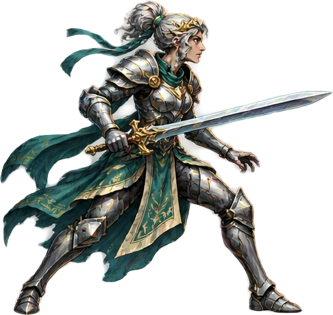
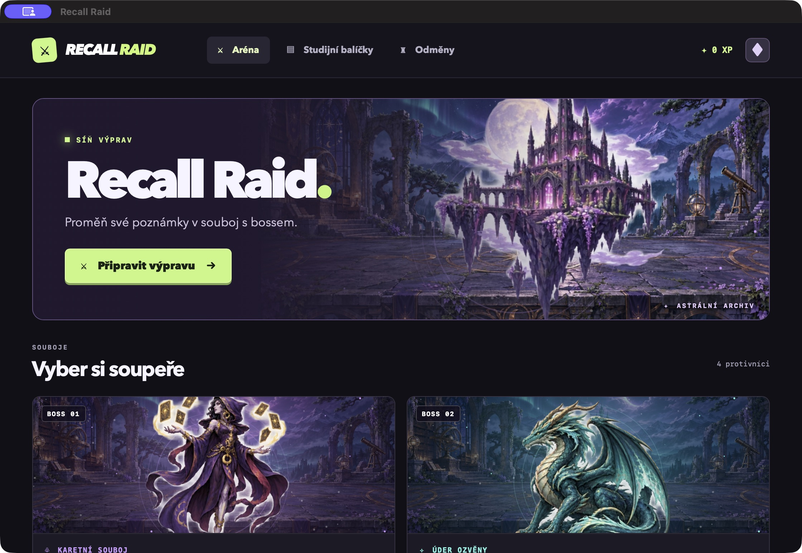

<h1 align="center">Recall Raid</h1>

<strong>Proměň svoje poznámky v souboj s bossem.</strong> Česká studijní hra pro Mac a prohlížeč. Správnou odpovědí nabíjíš kouzla, chybou dáváš soupeři šanci zaútočit.

## První výprava

1. Stáhni a rozbal ZIP. Na Macu s Apple silicon otevři aplikaci Recall-Raid. V prohlížečové verzi otevři soubor Recall-Raid.html.
2. Klikni na **Připravit výpravu**. Vlož poznámky nebo načti soubor TXT, Markdown či DOCX. Před soubojem si můžeš otázky upravit.
3. Vyber soupeře a podíl karet, které chceš zvládnout. Vex a Ignis začínají výběrem z karet, Nyx a Aster zkoušejí vybavování zpaměti.
4. Za správnou odpověď získáš energii. Vyber kouzlo a načasuj úder. K vítězství potřebuješ porazit bosse a splnit studijní cíl.

Hra funguje offline. Studijní balíčky, zkušenosti i získané relikvie se ukládají na zařízení. Aplikace pro macOS nemá notarizaci od Applu. Pokud ji systém zablokuje, použij balíček pro prohlížeč.

## Zdrojové soubory

Webovou verzi lze spustit přímo otevřením souboru `index.html`. V souboru `launcher.m` je zdroj macOS aplikace využívající WebKit.

Při vývoji hry a tvorbě ilustrací byla použita AI.
